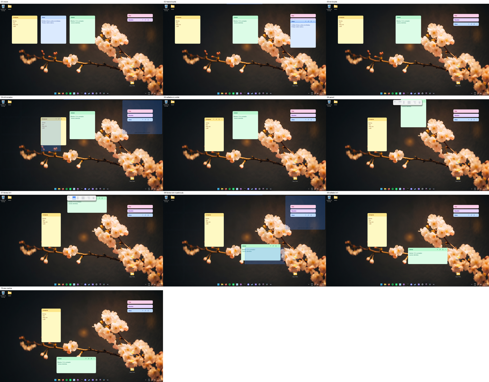
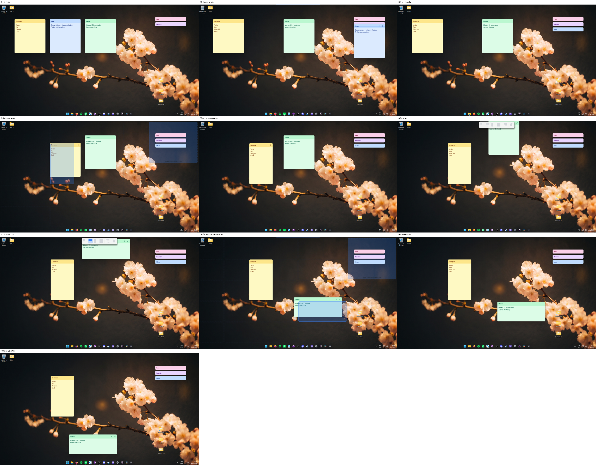
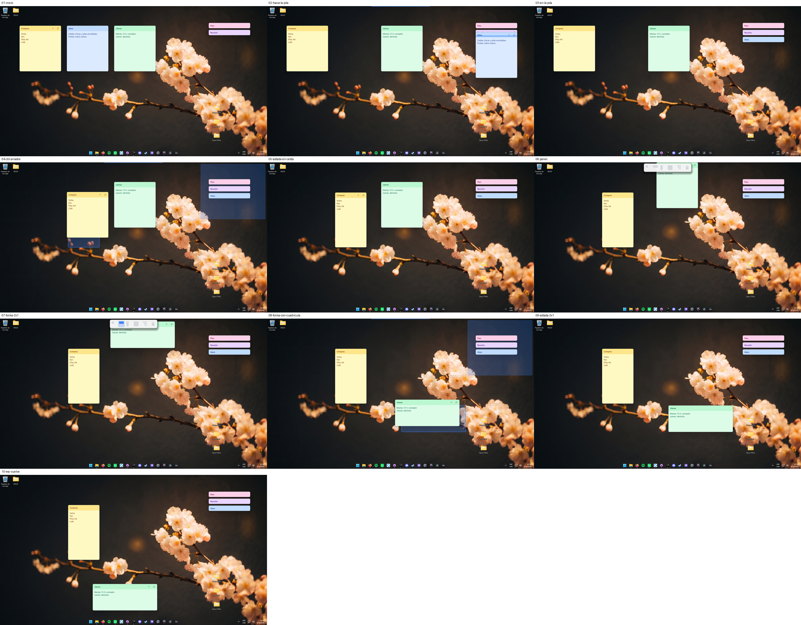
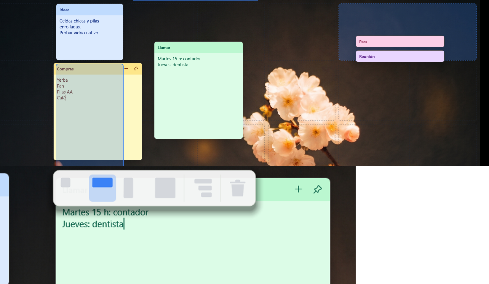
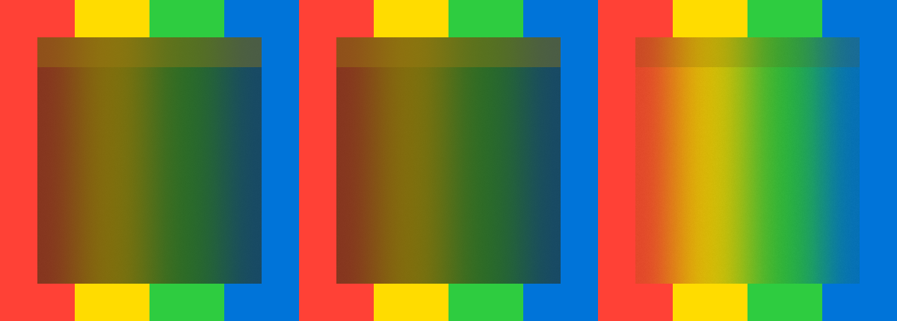
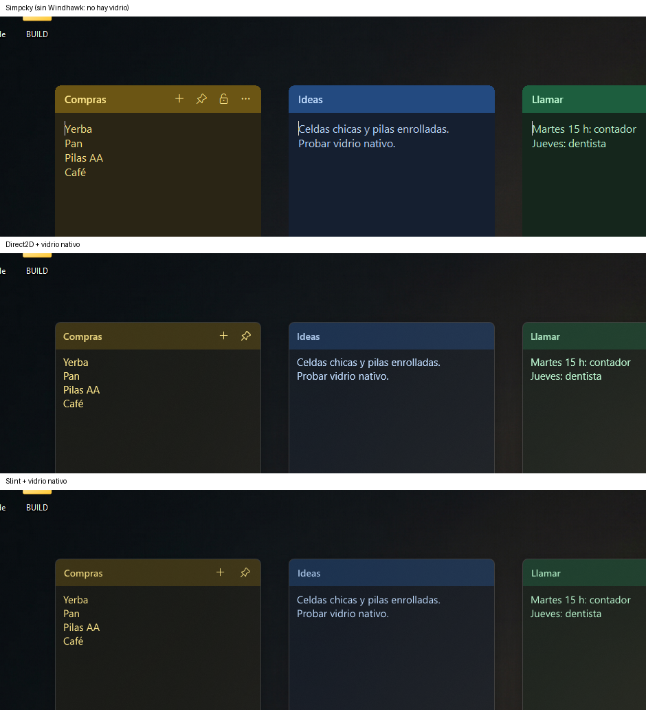

# Demos de interfaz: Direct2D propio y Slint (software)

Dos versiones de Simpcky con la misma funcionalidad y distinto dibujo, para
comparar rendimiento, **animaciones**, **celdas** y **transparencias** con la
app real. (La demo de Raven está aparte, en `raven/`.)

- `d2d/`: Direct2D + DirectWrite + DirectComposition, **un solo dispositivo de
  GPU para todas las notas**; editor de texto propio sobre DirectWrite.
- `slint/`: Slint 1.18 con su **renderizador por software**, sobre ventanas
  Win32 propias (sin winit): cada nota dibuja en un búfer que se presenta con
  `UpdateLayeredWindow`.
- `common/`: todo lo que no es dibujo, igual para las dos: la **geometría de
  celdas y pilas copiada de `src/snap.rs` con sus tests**, el motor de arrastre
  portado de `snap.rs`, las transiciones de `anim.rs`, el ritmo de cuadros, el
  vidrio nativo y el `notes.json`. Ver [SPEC.md](SPEC.md).

Ninguna toca `src/` ni las notas reales: leen `%APPDATA%\Simpcky\notes.json` la
primera vez y escriben en `%APPDATA%\SimpckyD2D` / `SimpckySlint`.

```powershell
cd demos
cargo build --release          # las dos (y common)
cargo test -p simpcky-demo-common   # la geometría de celdas: 8 tests de Simpcky
target\release\simpcky-d2d.exe
target\release\simpcky-slint.exe
```

Atajos en una nota: **Ctrl** al arrastrar = cuadrícula · llevar la nota al
**borde de arriba** = panel de formas/pila/tacho · **Ctrl+Mayús+clic** en la
barra = pila · **Ctrl+G** vidrio (apagado, suave, medio, fuerte) · **Ctrl+D**
oscuro · **Ctrl+N** nota nueva · **Ctrl+R** enrollar · **Ctrl+Mayús+T** siempre encima.

## Celdas: el mismo recorrido en las tres

`bench/tour.py` hace con mouse y teclado reales: llevar una nota a la pila,
Ctrl + arrastrar (cuadrícula, vista previa), llevar otra al borde (panel),
elegir 2×1, bajar y soltar, y Esc a mitad de un arrastre. Las tres hacen lo
mismo en cada paso:

| Simpcky | Direct2D | Slint |
|---|---|---|
|  |  |  |

Detalle de la demo Direct2D (cuadrícula punteada que no se dibuja bajo las
notas, zona de pila, panel con sombra y la forma elegida):



## Transparencia: vidrio nativo, sin Windhawk

Simpcky hoy necesita el mod "Translucent Windows" de Windhawk para el
desenfoque (`glass.rs`). Probado en esta máquina (Windows 11 25H2):
`SetWindowCompositionAttribute` con `ACCENT_ENABLE_BLURBEHIND` **y flags 0**
desenfoca de verdad lo que hay detrás, **también en ventanas en capas
(`UpdateLayeredWindow`)** como las de Simpcky y en ventanas DirectComposition.
Con flags 2 (lo que copian casi todos los ejemplos) sale casi negro, y
`DWMWA_SYSTEMBACKDROP_TYPE` en una ventana sin título da un gris liso.
No funciona en ventanas hijas (las notas ancladas a `Progman`); sirve para las
poseídas por el escritorio, que es lo que ya usa el modo vidrio.



Las dos demos usan eso (`common::win::set_blur`) con las opacidades de
`glass.rs`. Simpcky no puede mostrar vidrio en esta máquina porque no hay
Windhawk:



## Medición

Esta máquina: RTX 3080, monitor **1920 × 1080 a 400 Hz**, Windows 11 25H2.
Release de las tres, datos aislados, 3 corridas por caso (promedio).

### Fluidez (`bench/smooth.py`)

Mouse real a velocidad constante; la posición y el tamaño de la ventana se leen
desde afuera ~cada 1 ms, igual para las tres.

| | Simpcky (GDI) | Direct2D | Slint (software) |
|---|---|---|---|
| **Arrastre**: la nota sigue al cursor | 394 act./s, atraso 1,8 ms | 395 act./s, 1,5 ms | 386 act./s, 1,5 ms |
| atraso en píxeles (p95) | 2,4 px | 0 px | 0 px |
| **Encaje en la celda** (200 ms): pasos | 10 | 35 | 29 |
| cada cuánto un paso | 15,2 ms | 4,3 ms | 5,5 ms |
| **Enrollar** (170 ms): pasos | 10 | 56 | 56 |
| salto más grande | 79 px | 15 px | 19 px |
| intervalo más largo | 21–26 ms | 9 ms | 9 ms |
| tirones (> 25 ms) al abrir | 1,7 por animación | 0 | 0 |
| CPU arrastrando 1,7 s | 344 ms | 495 ms | 891 ms |
| CPU arrastrando con cuadrícula y soltando | 724 ms | 922 ms | 1063 ms |
| CPU enrollar + abrir | 130 ms | 63 ms | 135 ms |

Con vidrio (nivel medio) las demos dan lo mismo dentro del ruido (D2D 510 ms
y Slint 912 ms de CPU arrastrando; mismos pasos e intervalos).

### Memoria y arranque (`raven/bench/bench.py`, 10 s en reposo)

| Notas | | Memoria en uso | Privada | GPU dedicada | Hilos | 1.ª ventana | CPU en reposo |
|---|---|---|---|---|---|---|---|
| 1 | Simpcky | 25,9 MB | 5,0 MB | — | 7 | 80 ms | ~0 |
| 1 | Direct2D | 43,5 MB | 53,8 MB | 10,9 MB | 60 | 266 ms | ~0 |
| 1 | Slint | 11,9 MB | 2,4 MB | — | 5 | 81 ms | 0 |
| 5 | Simpcky | 26,2 MB | 5,2 MB | — | 8 | 73 ms | ~0 |
| 5 | Direct2D | 44,3 MB | 55,4 MB | 12,8 MB | 60 | 262 ms | ~0 |
| 5 | Slint | 16,2 MB | 5,4 MB | — | 5 | 84 ms | 0 |
| 20 | Simpcky | 26,6 MB | 5,6 MB | — | 8 | 75 ms | 0 |
| 20 | Direct2D | 45,1 MB | 56,7 MB | 18,4 MB | 61 | 262 ms | 0 |
| 20 | Slint | 32,2 MB | 16,7 MB | — | 5 | 87 ms | 0 |

Por nota: Simpcky ~40 KB · Direct2D ~80 KB de RAM + ~0,4 MB de GPU · Slint
~1,1 MB (sus dos búferes por nota). Ejecutable: Simpcky 0,6 MB (con Drive,
actualizador y cifrado) · Direct2D 0,4 MB · Slint 6,2 MB.

## Lectura

1. **La fluidez de las animaciones no la decide el motor de dibujo sino el
   reloj.** Simpcky avanza las transiciones con `SetTimer(10 ms)`, que Windows
   redondea a ~15,6 ms: 10 pasos por animación, saltos de ~80 px al enrollar y
   algún tirón. Las demos esperan cada cuadro del compositor (`DwmFlush`, ver
   `common/src/pump.rs`) y en este monitor de 400 Hz dan 35–56 pasos de 3–5 ms
   sin tirones. **Esto se puede llevar a Simpcky tal cual**, sin cambiar GDI:
   reemplazar el `SetTimer` de `anim.rs` y de `snap.rs` por el bombeo de
   `pump.rs`. Es el cambio que más se nota y el más barato.
2. **El arrastre ya es bueno en las tres** (sigue al cursor en ~1,5 ms). La
   diferencia está en lo que se mueve alrededor (vista previa, notas que se
   corren, el encaje), que es justo lo del punto 1.
3. **Vidrio sin Windhawk** (arriba): se puede sumar a Simpcky con lo que ya
   tiene, porque sus notas de vidrio ya son ventanas en capas de primer nivel.
4. **Direct2D** dibuja mejor (punteados, sombras, emojis en color, texto
   nítido), el costo por nota es mínimo y la capa de celdas es una sola
   superficie de GPU. Lo que cuesta: +18 MB de base y ~50 MB privados (el
   controlador de la GPU dentro del proceso, 60 hilos), arranque 190 ms más
   lento, y escribir todo a mano: el editor de la demo no tiene formato, y
   reemplazar el RichEdit (negrita, casillas, texto oculto) es mucho trabajo.
5. **Slint por software** es el más liviano en memoria y escribe la interfaz
   rápido, pero es el que más CPU gasta en movimiento: redibuja por software
   la capa de pantalla completa en cada cuadro (a 400 Hz, ~50 % de un núcleo
   mientras se arrastra). No tiene bordes punteados ni recortes "en negativo"
   (los huecos de la cuadrícula se borran a mano después de dibujar), su
   `TextInput` es texto plano y el binario pesa 6 MB.

**Recomendación:** quedarse con Win32/GDI para las notas y llevar a Simpcky
(a) el ritmo de cuadros de `pump.rs` y (b) el vidrio nativo. Si después se
quiere que la capa de celdas se vea mejor (punteados, sombras, fundidos más
finos), dibujar **solo esa capa** con Direct2D/DirectComposition, que es donde
GDI+ más sufre y donde D2D cuesta poco. Slint no conviene para esta app:
pierde en CPU justo en las animaciones, que es lo que se busca.

## Cómo se hizo

- `common/` (geometría, motor, transiciones, ritmo, vidrio) y la demo
  Direct2D: escritos en esta sesión. La geometría se copia de `src/snap.rs`
  con `tools/extract_geom.py` y pasa los mismos 8 tests.
- La demo Slint la escribió Codex (delegado) siguiendo `SPEC.md`. Al probarla
  con mouse real el arrastre no andaba: `WM_CAPTURECHANGED` cancelaba el
  arrastre, y volver a tomar la captura en la misma ventana ya manda ese aviso.
  Corregido (`slint/src/main.rs`), igual que los íconos y un texto mal codificado.
- Mediciones: `bench/run_all.sh` (resultados en `bench/results/`),
  `bench/tour.py` (capturas del recorrido), `bench/smooth.py` (fluidez).
  Mueven el mouse de verdad y muestran el escritorio con Win+D.

### Diferencias con la app

- Las ventanas de las demos son de primer nivel poseídas por el escritorio (como
  el modo vidrio de Simpcky), no hijas de `Progman`.
- Un monitor por arrastre, sin Ctrl + borde para redimensionar por celdas.
- Las capas de celdas se desvanecen al soltar (en Simpcky se cierran de golpe).
- Sin menú "⋯", bandeja, Drive, texto con formato ni "Todas las notas".
- Slint: la cuadrícula con borde continuo (no punteado) y sin portapapeles.
