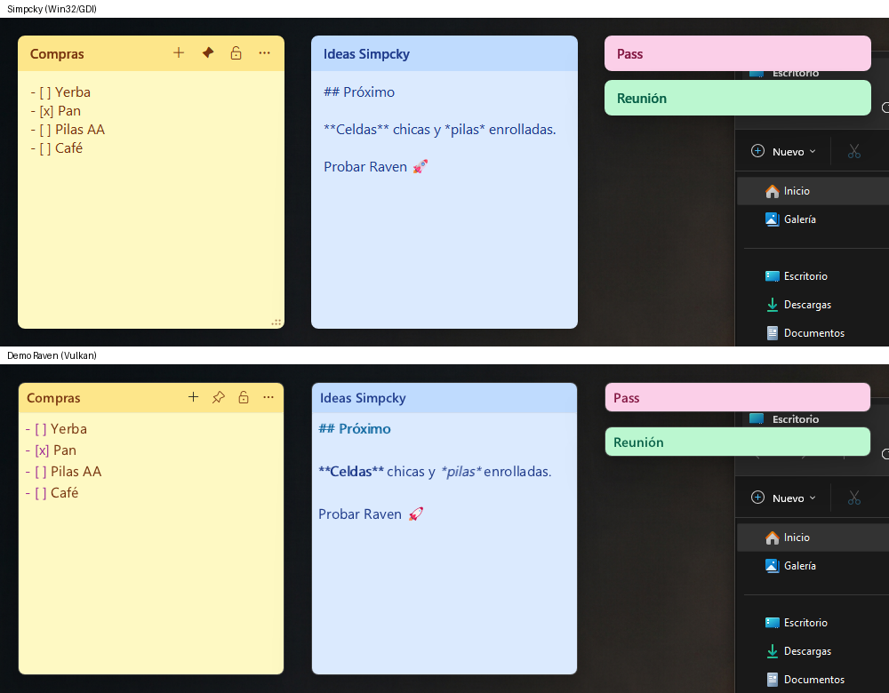
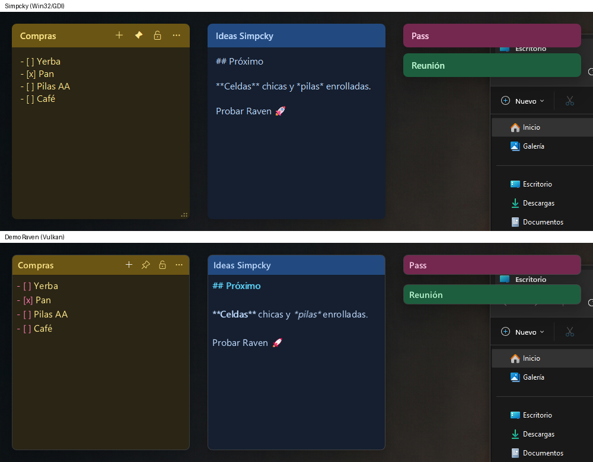
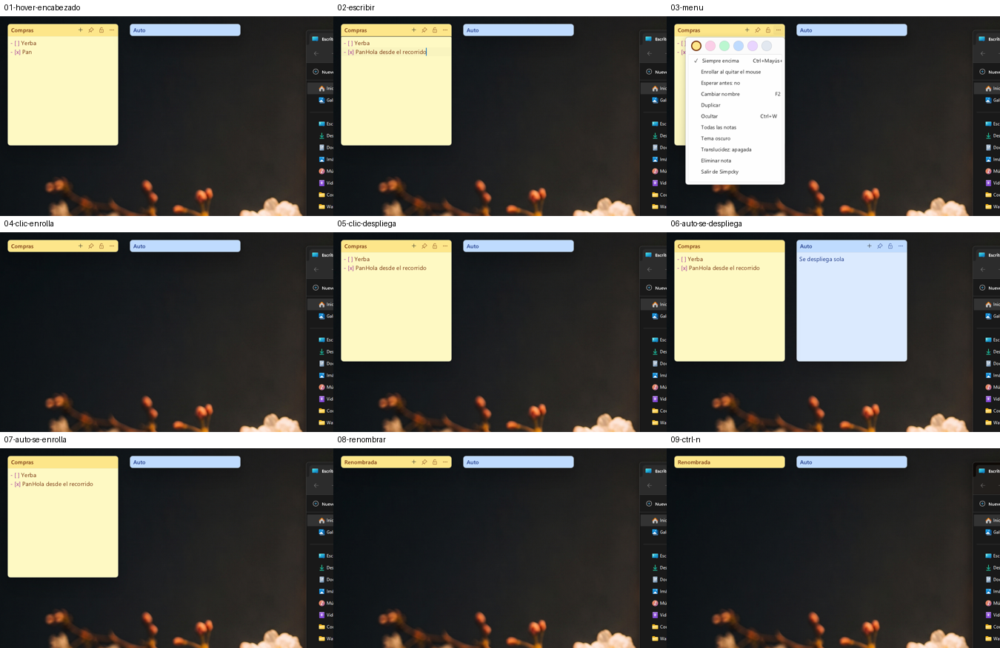

# Simpcky con Raven: demo y comparación

Una demo de Simpcky con la interfaz hecha en
[Raven](https://github.com/oscar-soirey/Raven) (biblioteca de interfaz en C que
dibuja con Vulkan) en lugar de Win32/GDI + RichEdit, para comparar memoria,
rendimiento y lo que cambia al programarla.

Es un crate aparte (`demos/raven`): no forma parte del build de la app ni
cambia nada de `src/`. Lee las notas de `%APPDATA%\Simpcky\notes.json` la
primera vez, pero **escribe solo en `%APPDATA%\SimpckyRaven`**: probarla no
toca las notas reales.




## Compilar y abrir

```powershell
powershell -ExecutionPolicy Bypass -File demos\raven\build.ps1
demos\raven\target\release\simpcky-raven.exe
```

`build.ps1` baja Raven en el commit fijado (`3b1a4df`, 2 de noviembre de
2026), lo compila como `raven.dll` con Visual Studio 2022 (instala CMake y
Ninja con pip si faltan), compila la demo y deja la DLL junto al `.exe`.
`SIMPCKY_RAVEN_LOG=1` escribe los errores de Raven y los clics del
encabezado en `%TEMP%\simpcky-raven.log`.

## Qué hace la demo

| | Simpcky | Demo Raven |
|---|---|---|
| Notas con encabezado de color, paleta clara y oscura | ✔ | ✔ (misma paleta) |
| Arrastrar por la barra; clic enrolla/despliega; doble clic renombra | ✔ | ✔ |
| Enrollado Manual / Auto, con espera antes de enrollar | ✔ | ✔ |
| Botones del encabezado solo con el mouse encima | ✔ | ✔ |
| Siempre encima, bloquear, color, duplicar, ocultar, eliminar | ✔ | ✔ |
| Atajos Ctrl+N, Ctrl+R, Ctrl+W, Ctrl+Mayús+T, F2 | ✔ | ✔ |
| "Todas las notas" con búsqueda | ✔ | ✔ (con memoria del proceso al pie) |
| Translucidez | ✔ (Windhawk) | ✔ (opacidad de la ventana) |
| Guardado en `notes.json` (mismo formato, escritura atómica) | ✔ | ✔ (conserva `fmt` sin interpretarlo) |
| Formato de texto | RichEdit: negrita, listas, casillas reales, texto oculto | Markdown resaltado donde está escrito (`**negrita**` sigue viéndose con asteriscos) |
| Nota anclada al escritorio (`WS_CHILD` de `Progman`) | ✔ | ✘: poseída por el escritorio (como las notas privadas de Simpcky) |
| Bandeja del sistema | ✔ | ✘ (Raven no la tiene): si no queda ninguna nota a la vista se abre "Todas las notas" |
| Celdas y pilas, sincronización con Drive, actualizaciones, cifrado, fuera de capturas | ✔ | ✘ (fuera del alcance de la demo) |



## Memoria y rendimiento

Medido el 3 de noviembre de 2026 en esta máquina (Windows 11, 16 hilos,
GPU NVIDIA), `cargo build --release` de las dos, datos aislados en una
carpeta temporal, notas de 280 × 320 con 10 líneas de texto. Promedio de 3
corridas; en reposo se muestrea 15 s después de que la memoria se estabiliza.

### En reposo

| Notas | | Memoria en uso (WS) | Memoria privada | GPU dedicada + compartida | Hilos | Handles | Primera ventana | CPU en reposo |
|---|---|---|---|---|---|---|---|---|
| 1 | Simpcky | 26,0 MB | 5,0 MB | — | 8 | 250 | 80 ms | 0,48 % |
| 1 | Raven | 134,0 MB | 172,4 MB | 28 + 44 MB | 40 | 545 | 537 ms | 0,17 % |
| 5 | Simpcky | 26,2 MB | 5,2 MB | — | 8 | 250 | 77 ms | 0,24 % |
| 5 | Raven | 217,1 MB | 276,1 MB | 59 + 115 MB | 48 | 786 | 524 ms | 0,35 % |
| 20 | Simpcky | 26,7 MB | 5,7 MB | — | 8 | 250 | 78 ms | 0,24 % |
| 20 | Raven | 514,2 MB | 630,2 MB | 169 + 361 MB | 78 | 1687 | 526 ms | 0,45 % |

(CPU en % de un núcleo. "—": Windows no le atribuye memoria de GPU a
Simpcky; GDI dibuja en la CPU y DWM compone.)

### En uso (5 notas abiertas)

| | Simpcky | Raven |
|---|---|---|
| CPU por carácter escrito (300 caracteres a ~50/s) | 5,0 ms | 4,3 ms (3,0 a 6,2 según la corrida) |
| Memoria por cada nota nueva (Ctrl+N × 10) | +0,03 MB | +21 MB en uso, +25 MB privada |
| CPU para crear 10 notas | 563 ms | 536 ms |

### Tamaño

| | Simpcky | Raven |
|---|---|---|
| Ejecutable | 585 KB (con Drive, actualizador y cifrado) | 244 KB + `raven.dll` 1,45 MB |

### Lectura

- **La memoria es la diferencia grande, y crece con cada nota.** Cada nota de
  Raven es una ventana con su propia superficie Vulkan (cadena de
  intercambio, imágenes intermedias y memoria del controlador): unos
  20 MB de memoria en uso y 24 MB privados más ~25 MB de GPU **por nota**.
  En Simpcky una nota cuesta unos 40 KB. Con 5 notas la demo usa 8 veces
  más memoria en uso y 53 veces más privada; con 20, 19 y 111 veces.
- La base fija de Raven (~110 MB con una nota) es el controlador Vulkan
  cargado en el proceso más los hilos de Raven (render, trabajadores): de
  8 hilos se pasa a 40.
- **Arranque**: la primera nota aparece en ~80 ms con Simpcky y ~530 ms con
  Raven (iniciar Vulkan).
- **CPU**: empatadas. En reposo las dos están cerca de 0 (Raven no
  redibuja si nada cambia); al escribir gastan lo mismo dentro del ruido.
- Para Simpcky, que vive todo el día en la bandeja con varias notas
  abiertas, el costo de memoria por nota es lo que decide.

Cómo repetirlo:

```powershell
python demos\raven\bench\bench.py --exe target\release\simpcky.exe --label Simpcky --out demos\raven\bench\results.json
python demos\raven\bench\bench.py --exe demos\raven\target\release\simpcky-raven.exe --label Raven --out demos\raven\bench\results.json
python demos\raven\bench\bench.py --compare demos\raven\bench\results.json
python demos\raven\bench\active.py --exe ... --label ... --out demos\raven\bench\active.json   # mueve mouse y teclado
```

`shot.py` saca capturas con notas de ejemplo e `interact.py` hace el
recorrido con mouse y teclado de la imagen de arriba.

## Recorrido por las diferencias de código

**1. Una ventana Win32 por nota → una ventana Raven por nota.**
`note.rs` crea la ventana, la ancla al escritorio, pinta el encabezado con
GDI y maneja cada mensaje (`WM_NCHITTEST`, `WM_PAINT`, `WM_MOUSEMOVE`…). En
la demo, `create_note` arma un árbol de widgets (`Border` → `VBox` →
encabezado + `TextEditor`) y Raven hace la distribución, el dibujo y el
foco. Es mucho menos código para lo mismo: la demo entera son ~1400 líneas
contra ~18 000 de la app (que hace bastante más).

**2. RichEdit → `TextEditor` con Markdown.** El RichEdit da formato real
(negrita aplicada, casillas que se tildan, texto oculto con `bAnimation`) y
Simpcky lo guarda en `fmt`. El editor de Raven resalta el Markdown pero
deja las marcas a la vista: no hay negrita "sin asteriscos" ni casillas
clicables. Migrar implicaría convertir `fmt` a Markdown o escribir un
editor propio. A favor de Raven: deshacer, selección, portapapeles y
emojis vienen hechos, y el texto no parpadea (no hizo falta nada como
`editor::paint_buffered`).

**3. Anclar al escritorio.** Simpcky hace a la nota hija de `Progman` con
`WS_EX_LAYERED` para que sobreviva a "Mostrar escritorio". Raven crea
ventanas de primer nivel con una superficie Vulkan; la demo las hace
*poseídas* por el escritorio (`win32::own_by_desktop`), lo mismo que
Simpcky usa para las notas privadas. Hacerlas hijas de `Progman` no se
probó: la decisión del 2026-10-29 (ARCHITECTURE.md) ya registra que en 24H2 una hija de
`Progman` solo se compone con `UpdateLayeredWindow`, que Vulkan no usa.

**4. Menús.** Los menús de Raven (`Rmenu_open`) se dibujan *dentro* de la
ventana que los abre: en una nota de 300 px salían recortados y tapaban la
nota. La demo hace el menú "⋯" como una ventana aparte (`open_flyout`,
fila de colores + lista), igual que el flyout de Simpcky. Cuesta otra
superficie Vulkan mientras está abierto.

**5. Salida del mouse.** El aviso `R_EVENT_MOUSE_LEAVE` no llegaba cuando
el cursor salía de golpe de la ventana, y el modo Auto no se enrollaba.
La demo mira cada 150 ms (solo mientras el mouse está encima) si el
cursor sigue sobre la ventana (`on_hover_poll`). Simpcky usa
`TrackMouseEvent`.

**6. Íconos.** Con un botón de 28 px el relleno interno de Raven dejaba a
la etiqueta sin lugar y los íconos salían cortados; se arregló con
`R_METRIC_PADDING_X/Y = 0` y la fuente puesta en la etiqueta hija del
botón. Los íconos son los mismos de Segoe Fluent Icons.

**7. Lo que falta en Raven y Simpcky usa:** bandeja del sistema, ventanas
en capas (`UpdateLayeredWindow`) para las capas de celdas y pilas, y
excluir ventanas de las capturas (posible con el `HWND` nativo, como el
anclaje).

**8. Estado y llamadas.** Las llamadas de Raven son funciones C con un
`user_data`; la demo guarda el estado en un `thread_local` y nunca llama a
Raven mientras lo tiene tomado (`with`), para que una llamada que vuelva a
entrar no choque. Es el mismo patrón que `app()` de Simpcky con su `Mutex`.

## Conclusión

Raven deja escribir la interfaz mucho más rápido y con menos código, y el
resultado se ve igual y no parpadea. Pero para una app de notas que queda
abierta todo el día, con una ventana por nota, el modelo de una superficie
Vulkan por ventana cuesta ~20–25 MB por nota (más memoria de GPU) contra
~40 KB, arranca medio segundo más lento y pierde el anclaje real al
escritorio, el RichEdit con formato y la bandeja. Con esta versión de
Raven, no conviene migrar Simpcky; sí podría servir para una ventana
grande y única (por ejemplo "Todas las notas" o Configuración) si algún día
pesan más que lo que ahorra GDI.
